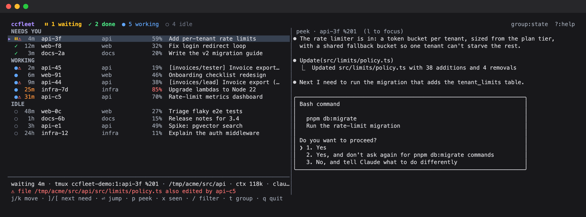
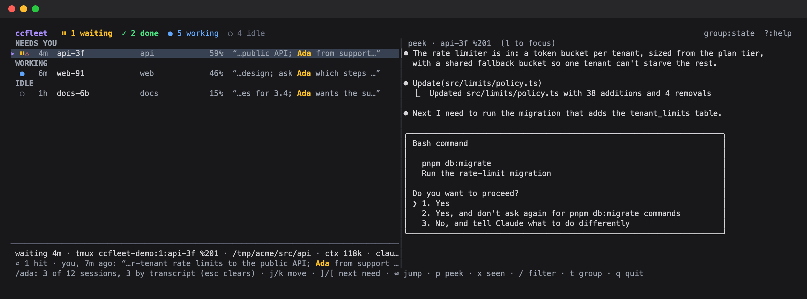

# ccfleet

A board for all your Claude Code sessions in tmux. It shows which ones are blocked on you,
which finished while you weren't looking, and what the rest are doing. Jump to any of them
in one keystroke.



## Why

Once you have 20+ agents, an alarm for every finished turn is just noise. ccfleet is quiet.
"Needs you" is a queue sorted by how long each session has waited, and a count sits in
the tmux status line. You check it when you choose to.

| | State | Meaning |
|---|---|---|
| ⏸ | waiting | blocked on a permission prompt or a question |
| ✓ | done | finished a turn since you last looked |
| ● | working | busy. An orange age means no activity for 10 minutes, so it may be stuck |
| ○ | idle | finished, and you've seen it |
| ⚠ | collision | another session in the same checkout edited the same file in the last 30 minutes, or is working on the same branch |

Press `/` to search every session's transcript, not just titles. It's handy when all you
remember is a name or a phrase from your prompt:



A session counts as seen when its pane is visible, when you jump to it, or when you press `x`.
With the optional focus hook, focusing the pane anywhere in tmux also counts.

## Install

```sh
go install github.com/jdbrewer/ccfleet@latest   # lands in $(go env GOPATH)/bin; put that on PATH
# or from a clone: go build -o ~/.local/bin/ccfleet .
ccfleet tmux-snippet               # review it, then append it to ~/.tmux.conf
tmux source ~/.tmux.conf
```

Requires tmux 3.2+ (popups) and Go 1.24+. Developed on macOS; Linux should work.

The snippet binds `prefix a` to open the board in a popup (Enter jumps and the popup closes),
adds the badge to `status-right` and sets `status-interval 5`, and adds an optional `pane-focus-in` hook. The hook needs `focus-events on`, which the snippet also sets.

## Commands

- `ccfleet`: the board. Pass `--client '#{client_tty}'` when you run it from a popup.
- `ccfleet ls [--json]`: a snapshot for scripts
- `ccfleet grep [--json] TERMS...`: which live sessions mention all the terms, with a snippet (your prompts first)
- `ccfleet badge`: `⏸1 ✓2 ●6` with tmux colour codes
- `ccfleet tmux-snippet`: config to paste into tmux.conf

## Keys

| Key | Action |
|---|---|
| `j` `k`, counts like `5j` | move |
| `gg` `G` | top, bottom |
| `C-d` `C-u` / `C-f` `C-b` | half page / full page |
| `]` `[` | next / previous session that needs you |
| `Enter` `o` | jump to its tmux pane |
| `x` | mark seen without jumping |
| `p` | toggle the live peek (beside the list at ≥150 columns, below it otherwise) |
| `l` `h` / `Tab` | focus peek / list. In the peek, `j k gg G C-d C-u` scroll |
| `/` | search by space-separated terms. Matches names, titles, branches **and full transcripts**: your prompts, Claude's replies, tool output. Rows matched by transcript show a snippet. `Enter` keeps the search, `Esc` clears it |
| `t` | group by state, tmux window, or repo |
| `?` | help |
| `q` | quit |

## How it works

ccfleet only reads files. It needs no hooks and no daemon. It joins:

- `~/.claude/sessions/<pid>.json`: status, tmux pane, cwd (live pids only)
- `~/.claude/projects/*/<sessionId>.jsonl`: title, branch, current tool, context size, edited files (tailed by byte offset)
- `~/.claude/teams/*/config.json`: agent-team lead and teammates
- `tmux list-panes` / `capture-pane`: which panes are visible, plus the peek

The screenshots come from a made-up fleet. `python3 scripts/demo/demo.py` rebuilds them,
and `--keep` leaves the demo tmux session running so you can try the board without real sessions.

These are internal Claude Code formats and may change. All the parsing lives in `internal/fleet`.
`CLAUDE_CONFIG_DIR` and `XDG_STATE_HOME` are honoured.
