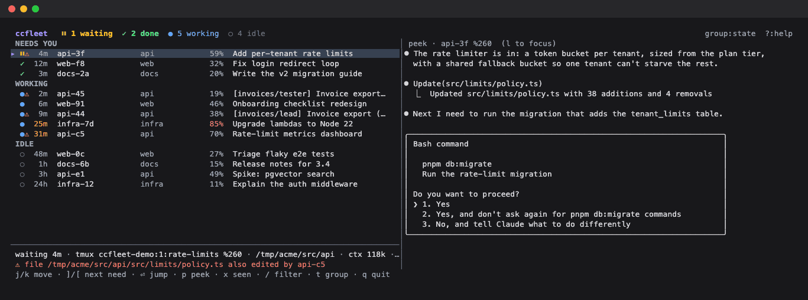

# ccfleet

A board for all your Claude Code sessions in tmux. It shows which ones are blocked on you,
which finished while you weren't looking, and what the rest are doing. Jump to any of them
in one keystroke.



## Why

Once you have 20+ agents, an alarm for every finished turn is just noise. ccfleet is quiet.
"Needs you" is a queue sorted by how long each session has waited, and a count sits in
the tmux status line. You check it when you choose to.

| | State | Meaning |
|---|---|---|
| ⏸ | waiting | blocked on a permission prompt or a question |
| ✓ | done | finished a turn since you last looked |
| ● | working | busy. An orange age means no activity for 10 minutes, so it may be stuck |
| ○ | idle | finished, and you've seen it |
| ⚠ | collision | another session in the same checkout edited the same file in the last 30 minutes, or is working on the same branch |

Press `/` to search every session's transcript, not just titles. It's handy when all you
remember is a name or a phrase from your prompt:


A session counts as seen when its pane is visible, when you jump to it, or when you press `x`.
With the optional focus hook, focusing the pane anywhere in tmux also counts.

## Install

```sh
brew tap jdbrewer/ccfleet https://github.com/jdbrewer/ccfleet
brew install ccfleet
```

Or download a binary for macOS or Linux from [Releases](https://github.com/jdbrewer/ccfleet/releases),
or `go install github.com/jdbrewer/ccfleet@latest` (lands in `$(go env GOPATH)/bin`).

Then add the tmux bindings:

```sh
ccfleet tmux-snippet               # review it, then append it to ~/.tmux.conf
tmux source ~/.tmux.conf
```

The snippet binds `prefix a` to open the board in a popup (Enter jumps and the popup closes).
It adds the badge to `status-right` and sets `status-interval 5`. It also adds an optional
`pane-focus-in` hook and sets `focus-events on`, which the hook needs.

Requires tmux 3.2+ (popups) and Claude Code. It runs on macOS and Linux. CI runs an
end-to-end check on both against a fake fleet of sessions in real tmux.

## Commands

- `ccfleet`: the board. Pass `--client '#{client_tty}'` when you run it from a popup.
- `ccfleet ls [--json]`: a snapshot for scripts
- `ccfleet grep [--json] TERMS...`: which live sessions mention all the terms, with a snippet (your prompts first)
- `ccfleet badge`: `⏸1 ✓2 ●6` with tmux colour codes
- `ccfleet tmux-snippet`: config to paste into tmux.conf

## Keys

| Key | Action |
|---|---|
| `j` `k`, counts like `5j` | move |
| `gg` `G` | top, bottom |
| `C-d` `C-u` / `C-f` `C-b` | half page / full page |
| `]` `[` | next / previous session that needs you |
| `Enter` `o` | jump to its tmux pane |
| `x` | mark seen without jumping |
| `p` | toggle the live peek (beside the list at ≥150 columns, below it otherwise) |
| `l` `h` / `Tab` | focus peek / list. In the peek, `j k gg G C-d C-u` scroll |
| `/` | search by space-separated terms. Matches names, titles, branches **and full transcripts**: your prompts, Claude's replies, tool output. Rows matched by transcript show a snippet. `Enter` keeps the search, `Esc` clears it |
| `t` | group by state, tmux window, or repo |
| `?` | help |
| `q` | quit |

## How it works

ccfleet only reads files. It needs no hooks and no daemon. It joins:

- `~/.claude/sessions/<pid>.json`: status, tmux pane, cwd (live pids only)
- `~/.claude/projects/*/<sessionId>.jsonl`: title, branch, current tool, context size, edited files (tailed by byte offset)
- `~/.claude/teams/*/config.json`: agent-team lead and teammates
- `tmux list-panes` / `capture-pane`: which panes are visible, plus the peek

`CLAUDE_CONFIG_DIR` and `XDG_STATE_HOME` are honoured.

## Limitations

- **It reads Claude Code's internal files.** Those formats aren't a public API and can change
  in any release. The parsing is isolated in `internal/fleet`. If the session files stop
  parsing, ccfleet falls back to the documented `claude agents --json` and finds panes through
  the process tree. You keep the board, but lose how long each session has been in its state.
- **Jump and peek need tmux.** `ccfleet ls` and `ccfleet grep` work anywhere.
- **Search covers live sessions only**, and only the first 16KB of each tool output.
- **Collisions only see Claude's Edit and Write tools.** A file changed with `sed` in Bash isn't counted.
- **"Done" depends on knowing what you've looked at**: visible panes, jumps, `x`, and the
  optional focus hook. A pane you read without focusing it still counts as unseen.
- **Context % assumes a 200k window**, unless the model name or token count says 1M.
- macOS and Linux only.

## Similar tools

| Tool | What it is | Where ccfleet differs |
|---|---|---|
| Claude Code's agent view (`claude agents`) | Built-in dashboard for dispatching and supervising background sessions | Watches the interactive sessions you already run in tmux panes, and adds a live peek, jump, transcript search and collision warnings |
| [tmux-claude-hatch](https://github.com/craftzdog/tmux-claude-hatch) | tmux plugin that runs a Claude session per project in a popup, with an fzf picker (status and preview) and a bell on the window that needs you | Closest in spirit. ccfleet hosts nothing: it watches sessions wherever they already run, uses a quiet queue instead of bells, and adds full-transcript search, collisions and teams |
| [claude-squad](https://github.com/smtg-ai/claude-squad) | Launches and manages agents, each in its own tmux session and git worktree | ccfleet launches nothing. It's read-only over whatever you already run |
| [ccmanager](https://github.com/kbwo/ccmanager) | Session manager across git worktrees, no tmux | ccfleet is tmux-native: popup, jump, pane peek |
| [atm](https://docs.rs/crate/atm) | Rust dashboard plus daemon that can spawn, kill and message agents, with cost tracking | ccfleet has no daemon and doesn't control agents. It stays out of the way and tells you where to look |

The screenshots come from a made-up fleet. `python3 scripts/demo/demo.py` rebuilds them,
`--keep` leaves the demo tmux session running so you can try the board without real sessions,
and `--check` runs the same end-to-end assertions as CI.
